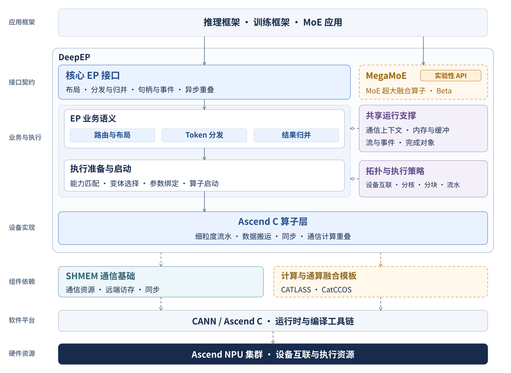

# DeepEP for Ascend

[简体中文](README.zh-CN.md) | English

An expert-parallel communication library for Ascend NPUs, designed for token dispatch, result combine, and routing layouts in mixture-of-experts workloads.

The planned `deep_ep` package follows DeepEP V1/V2 user workflows. Device kernels use AscendC with SHMEM as the initial communication foundation. MegaMoE Beta is a separately organized experiment for communication and expert-compute fusion.

> **Early development.** APIs, installable packages, and runnable examples are not yet available. See the [roadmap](docs/roadmap.md) for implementation and device validation status.

## Architecture



Public Python APIs delegate to native bindings and EP operations, then execution preparation and complete AscendC kernels. `runtime/` owns persistent resources and completion objects. Shared device components are extracted into `device/` when actual reuse justifies them. SHMEM and optional CATLASS/CatCCOS dependencies will be resolved by the root build.

## Planned features

| Area | Target entry | Current status |
| --- | --- | --- |
| V1 EP | `Buffer`; layout, dispatch, combine | Planned |
| V1 low latency | Dedicated dispatch/combine workflows | Planned; separate qualification |
| V2 EP | `ElasticBuffer`, `EPHandle` | Planned |
| Communication/computation overlap | Events and asynchronous options | Planned |
| MegaMoE Beta | `deep_ep_experimental.megamoe` | Planned; optional build |

Compatibility will be checked against a pinned upstream API revision, including imports, arguments, return layouts, handle reuse, and completion behavior. See the [API plan](docs/api.md) and [roadmap](docs/roadmap.md).

## Repository layout

```text
DeepEP/
├── deep_ep/              # Python API families and completion helpers
├── csrc/                 # Bindings, ops, runtime, execution, kernels, device
├── cmake/                # Host/AscendC build and install rules
├── third-party/          # Pinned dependency sources or SDK integration
├── configs/              # Topologies, execution policies, release presets
├── tests/                # API, V1/V2 correctness, integration
├── benchmarks/           # Communication measurements and result records
├── examples/             # Complete public API workflows
├── experiments/megamoe/  # Self-contained optional Beta implementation
├── docs/                 # Architecture, API, build, performance, development
└── figures/              # Documentation diagrams
```

Directory READMEs describe module responsibilities. See the [repository layout](docs/repository-layout.md) for the planned source organization and file responsibilities.

## API workflows

The target V1 workflow is layout preparation → dispatch → expert computation → combine. V2 uses `ElasticBuffer` and `EPHandle`, with expert computation consuming the selected returned layout. Asynchronous consumers must establish the required completion dependency before reading communication results.

The framework or a selected fusion implementation performs expert computation. Exact signatures, weighting rules, supported dtypes, and Ascend tuning semantics will be documented against the chosen baseline in [docs/api.md](docs/api.md).

## Performance

No device measurements are available yet. EP results will report dispatch/combine latency and a stated bandwidth definition. MegaMoE results will report full-workflow latency against a semantically equivalent baseline. Every result must identify the revision, environment, topology, shapes, precision, timing boundary, and reproduction command. See the [measurement protocol](docs/performance.md) and [result template](benchmarks/results/template.csv).

## Requirements and installation

The target environment includes Ascend NPUs, a matched driver/CANN/AscendC stack, SHMEM, Python, PyTorch, and `torch_npu`. Exact versions and device support remain to be validated. CATLASS and CatCCOS are optional dependencies selected by the implementation.

Clone the repository:

```bash
git clone https://gitcode.com/Ascend/DeepEP.git
cd DeepEP
```

Installation is not available yet. See [build and packaging](docs/build.md) for the planned build pipeline, dependencies, and artifacts.

## MegaMoE Beta

[experiments/megamoe/](experiments/megamoe/README.md) owns the planned fused workflow, native extension, Python namespace, configuration, tests, and benchmark entry. The target composition is dispatch–GMM–activation–GMM–combine. Kernel boundaries and optional quantization depend on the selected implementation.

`DEEPEP_BUILD_MEGAMOE` is a planned build option, defaulting to `OFF`. Beta API and performance qualification will be versioned independently of the core API.

## Development and testing

Start with the [architecture](docs/architecture.md), [development guide](docs/development.md), and [contribution guide](CONTRIBUTING.md). The [test plan](tests/README.md) covers API compatibility, numerical correctness, resource ownership, and installation. [Examples](examples/README.md) will demonstrate complete V1/V2 workflows; [benchmarks](benchmarks/README.md) will measure device performance.

## Roadmap

1. Implement the root build, dependency resolution, package layout, and artifact collection.
2. Implement and qualify V1/V2 workflows against a pinned API baseline.
3. Deliver and qualify the optional MegaMoE Beta with reproducible measurements.
4. Extract shared device components where concrete consumers establish a stable contract.

See the [roadmap and qualification matrix](docs/roadmap.md) for completion criteria.

## Contributing and licensing

Contributions should include the affected workflow, build scope, and correctness/performance evidence; see [CONTRIBUTING.md](CONTRIBUTING.md). A project license and third-party notices have not yet been published.
