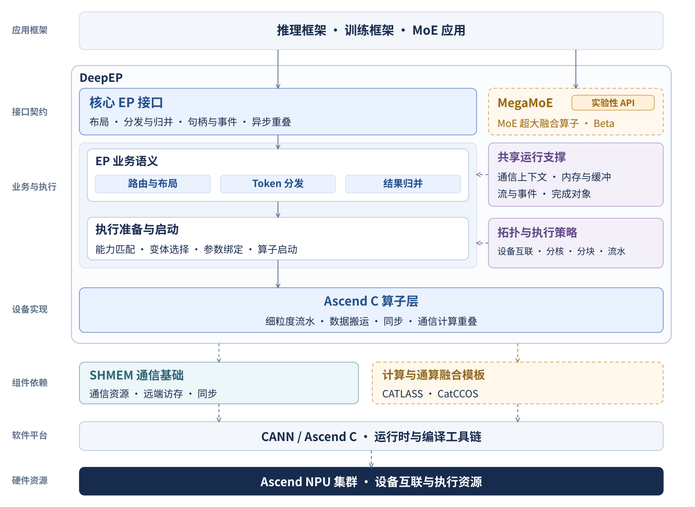

# DeepEP 昇腾版

简体中文 | [English](README.md)

面向 Ascend NPU 的专家并行（Expert Parallelism，EP）通信库，为 MoE 训练和推理提供 token 分发、结果归并与路由布局支持。

项目计划通过 `deep_ep` 提供原生 DeepEP 风格的 V1/V2 用户接口，以 AscendC 实现设备算子，以 SHMEM 作为首发通信基础。MegaMoE Beta 作为独立实验单元，探索通信与专家计算融合。

> **项目处于早期开发阶段。** API、安装包和可运行示例尚未提供。实现进度及设备验证状态见[路线图](docs/roadmap.md)。

## 架构



公开 Python API 经原生绑定与 EP 业务操作，进入执行准备，再启动完整 AscendC Kernel。`runtime/` 负责跨调用资源与完成对象；`device/` 中的共享组件随真实复用形成。根构建统一解析 SHMEM 及按实现选择的 CATLASS、CatCCOS 依赖。

## 规划功能

| 功能 | 目标入口 | 当前状态 |
| --- | --- | --- |
| V1 专家通信 | `Buffer`；layout、dispatch、combine | 待实现 |
| V1 低时延 | 专用 dispatch/combine 流程 | 待实现、单独验证 |
| V2 专家通信 | `ElasticBuffer`、`EPHandle` | 待实现 |
| 通信计算重叠 | 事件与异步选项 | 待实现 |
| MegaMoE Beta | `deep_ep_experimental.megamoe` | 待实现、可选构建 |

API 一致性覆盖导入、参数、返回布局、handle 复用和完成行为。功能资格以固定的原生 API 基线及目标设备验证记录为准，详见 [API 规划](docs/api.md)和[路线图](docs/roadmap.md)。

## 目录结构

```text
DeepEP/
├── deep_ep/              # Python API 家族与完成包装
├── csrc/                 # bindings、ops、runtime、execution、kernels、device
├── cmake/                # Host/AscendC 构建与安装规则
├── third-party/          # 固定版本依赖源码或 SDK 接入
├── configs/              # 拓扑、执行策略、发行预设
├── tests/                # API、V1/V2 正确性、集成验证
├── benchmarks/           # 通信性能测量与结果记录
├── examples/             # 完整公开 API 使用流程
├── experiments/megamoe/  # 独立、可选的 Beta 实现单元
├── docs/                 # 架构、API、构建、性能、开发说明
└── figures/              # 文档图稿
```

各模块 README 说明维护职责；[目录设计](docs/repository-layout.md)列出规划中的源码组织与文件分工。

## 用户 API 与业务流程

V1 目标流程为布局准备 → dispatch → 专家计算 → combine。V2 通过 `ElasticBuffer` 和 `EPHandle` 组织调用，专家计算消费对应返回布局。异步路径在读取通信结果前建立必要的完成依赖。

专家计算由框架或选定融合实现负责。具体签名、权重处理、数据类型及 Ascend 调优语义将在固定接口基线后写入 [docs/api.md](docs/api.md)。

## 性能

目前没有目标设备实测数据。标准 EP 分别报告 dispatch/combine 延迟，并说明带宽计算口径；MegaMoE 报告相同业务语义下的完整流程延迟及基线。每条结果记录源码版本、环境、拓扑、shape、精度、计时边界和复现命令。

测量要求见[性能文档](docs/performance.md)，结果格式见 [CSV 模板](benchmarks/results/template.csv)。

## 环境与安装

目标环境包含 Ascend NPU、匹配的驱动/CANN/AscendC、SHMEM、Python、PyTorch 和 `torch_npu`。具体版本与设备支持待验证；CATLASS 和 CatCCOS 按实际实现选用。

获取仓库：

```bash
git clone https://gitcode.com/Ascend/DeepEP.git
cd DeepEP
```

安装方式尚未开放。构建流程、依赖和产物规划见[构建与打包](docs/build.md)。

## MegaMoE Beta

[experiments/megamoe/](experiments/megamoe/README.md)集中承载融合流程、原生扩展、Python 命名空间、配置、测试及性能入口。目标逻辑为 dispatch–GMM–激活–GMM–combine；Kernel 边界和可选量化由具体实现确定。

`DEEPEP_BUILD_MEGAMOE` 为规划中的构建开关，默认 `OFF`。Beta 接口与性能资格按版本单独维护。

## 开发与测试

开发入口包括[架构](docs/architecture.md)、[开发指南](docs/development.md)和[贡献指南](CONTRIBUTING.md)。[测试规划](tests/README.md)覆盖 API 兼容性、数值正确性、资源所有权和安装；[示例](examples/README.md)将展示完整 V1/V2 流程，[性能入口](benchmarks/README.md)负责设备测量。

## 路线图

1. 实现根构建、依赖解析、包结构和产物收集。
2. 对照固定 API 基线实现并验证 V1/V2 业务流程。
3. 交付可选 MegaMoE Beta，提供正确性和可复现性能记录。
4. 根据真实消费者和稳定契约提炼共享设备组件。

完成标准见[路线图与资格矩阵](docs/roadmap.md)。

## 贡献与许可

贡献需说明对应调用流程、构建范围及正确性/性能证据，详见 [CONTRIBUTING.md](CONTRIBUTING.md)。项目许可证及第三方版权声明尚未发布。
