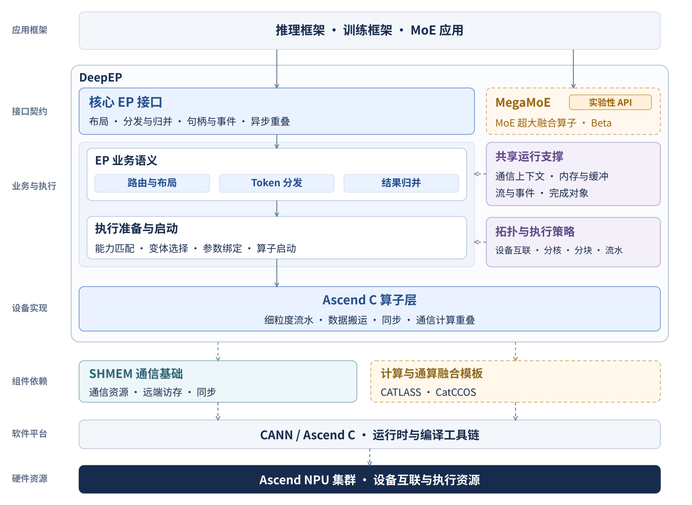

# 架构设计

本文介绍 DeepEP 昇腾版的目标架构、模块职责与依赖关系。各模块的实现和验证进展见[路线图](roadmap.md)。

## 产品边界

核心 EP 负责 MoE 的 token 分发、回收归并与布局组织。模型路由与专家计算由调用框架负责；选定的 MegaMoE 实验实现可以将通信与专家计算放入同一优化流程。V1/V2 接口家族分别维护调用与数据契约。



## 模块职责

| 模块 | 负责 | 主要协作 |
| --- | --- | --- |
| `deep_ep/` | 用户参数、公开对象、返回组织、完成包装 | 将实际操作委托给原生扩展 |
| `csrc/bindings/` | Python/native 注册与类型转换 | 调用 ops，连接 runtime 对象 |
| `csrc/ops/` | EP 输入语义、路由、布局、handle 条件 | 使用 runtime，向 execution 提出需求 |
| `csrc/runtime/` | 跨调用上下文、资源集合、事件与生命周期 | 为核心和按需接入的 Beta 提供支撑 |
| `csrc/execution/` | 执行准备、已编译变体查询与启动 | 在支持域内选择实现并绑定参数与流 |
| `csrc/kernels/` | 完整 AscendC 算子、流水和私有辅助 | 消费 SHMEM、选定模板与内部参数声明 |
| `csrc/device/` | 有明确消费者的共享设备源码 | 按真实复用形成，当前仅预留职责位置 |

`runtime` 管理持续资源，`execution` 组织单次请求。`ops` 掌握业务含义，`execution` 选择具体实现。这些职责可以协作于同一进程和共享库，不要求额外的运行时调用层级。

## 调用链与数据流

```text
模型路由
  → Python Buffer / ElasticBuffer
  → deep_ep._C：python_api + bindings
  → ops：输入、布局与 handle 语义
  → execution：plan → compiled variants → launcher
  → AscendC dispatch Kernel
  → 按返回布局进行专家计算
  → 对应 combine Kernel
  → 回到原始 token 布局

runtime 为上述操作提供上下文、资源与完成对象。
```

V1 高吞吐流程包含布局准备。V1 低时延有单独方法及完成方式，按模式记录资格。V2 通过 `ElasticBuffer`、`EPHandle` 衔接布局和业务调用。缓存路径仅在基线规定的路由、布局与资源条件成立时复用 handle。

## 参数与变体

`csrc/kernel_args.hpp` 规划为 Host/Device 共用内部参数的单一声明源。公开 `Config` 的 native 定义规划在 `ops/config.hpp`。编译变体由 `kernels/variants.json` 声明，构建生成实际启用索引，`execution/variants.*` 查询该索引。

拓扑描述资源连接，策略描述分核、分块、流水等实现选项，发行预设选择功能与配套。运行地址和资源引用在当前进程绑定，不持久化到配置中。

## 依赖与构建

SHMEM 为首发通信基础；CATLASS、CatCCOS 按具体实现选用。根构建解析一组确定的版本和路径，各 target 消费其编译与链接要求。依赖源码组织不改变本库模块职责。

目标构建链为 PEP 517 → setuptools → `build_support.py` → 根 CMake → Host/AscendC 编译 → 安装暂存树 → Python 发行物，详见[构建文档](build.md)。

## MegaMoE

`experiments/megamoe/` 是完整 Beta 单元，包含绑定、Host 操作、融合 Kernel、Python 包、配置、测试与测量入口。命名空间为 `deep_ep_experimental.megamoe`，原生扩展为其独立 `_C`。核心与 Beta 通过明确所有权的公共资源协作。

默认计划构建核心；Beta 由 `DEEPEP_BUILD_MEGAMOE=ON` 显式选择。该开关同时控制源码、扩展、Python 包及配置的安装。具体 Kernel 划分按实际算法与工具链能力确定。

## 文件形成原则

完整算子及私有辅助留在同域。跨算子共享代码在消费者、状态、完成条件及测试契约明确后提炼；`device/` 当前没有共享实现。成对 `.hpp/.cpp` 是推荐落位，小型实现可以合并。完整目标文件清单见[目录设计](repository-layout.md)。
