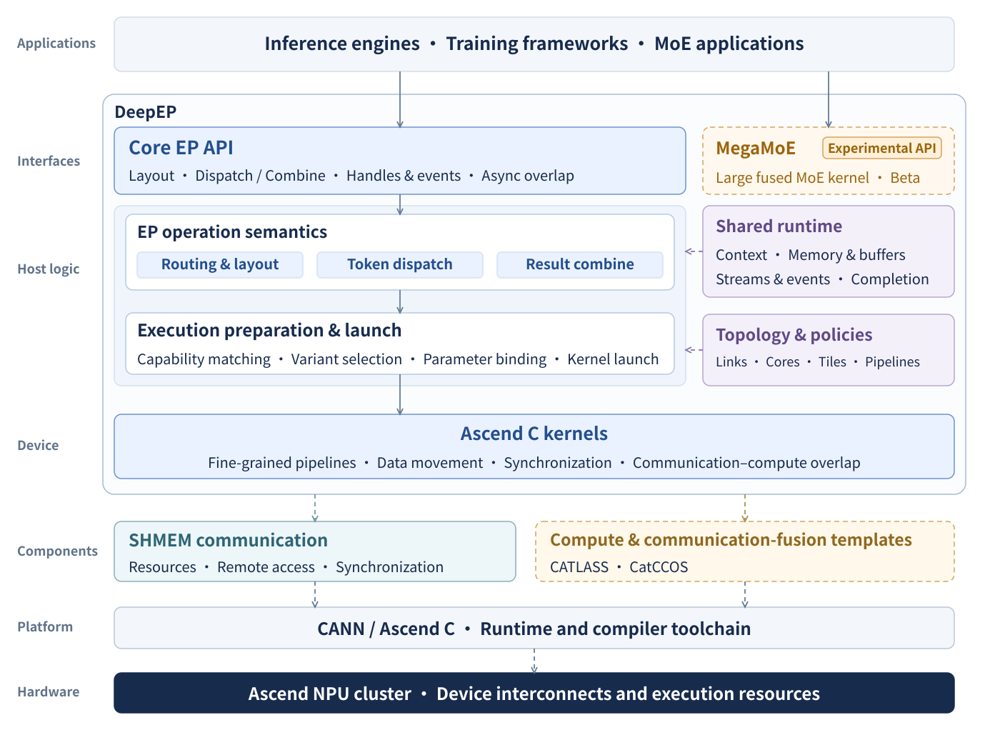
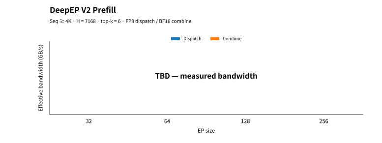
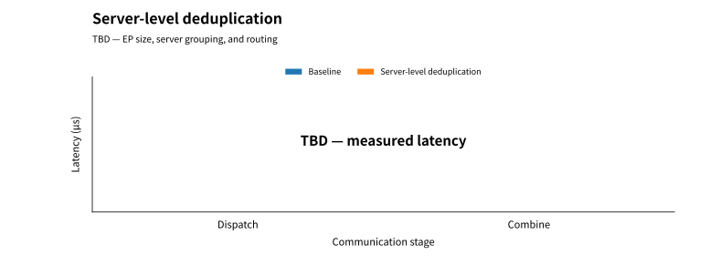
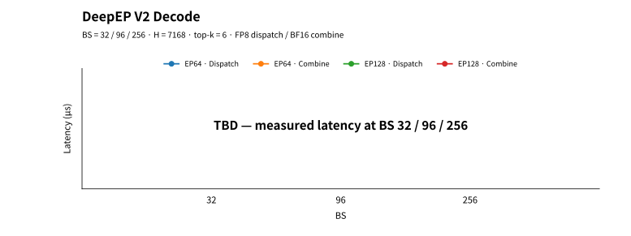
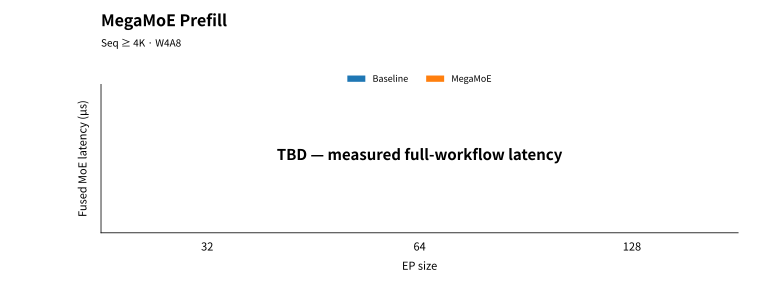
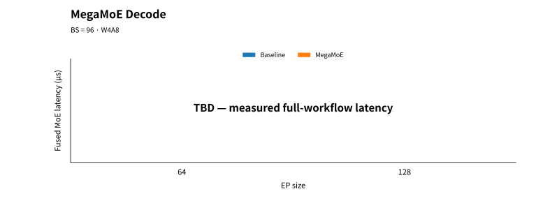

# DeepEP

---

[简体中文](README.md) | English

**DeepEP on Ascend** (`Ascend/DeepEP`) is an expert-parallel (EP) communication library for mixture-of-experts (MoE) inference on Ascend NPUs. It provides high-throughput **prefill** and low-latency **decode** communication, together with experimental **MegaMoE** fused inference.

## News

---

**DeepEP V2 on Ascend.** Prefill and decode share the `deep_ep.ElasticBuffer` interface and its `dispatch()` / `combine()` operations.

### New features

- **High-throughput prefill:** URMA dispatch and combine, integrated notify, and server-level token deduplication for EP32/64/128/256.
- **Low-latency decode:** small-batch dispatch and combine through the same V2 interface for EP64/128.
- **MegaMoE prefill (experimental):** W4A8 fused communication and expert computation for EP32/64/128.
- **MegaMoE decode (experimental):** small-batch W4A8 fused inference for EP64/128, using the same MegaMoE forward entry as prefill.

### Architecture

DeepEP connects inference frameworks to Ascend communication kernels through V2. MegaMoE integrates token communication, expert computation, activation, and quantization into a fused forward workflow.

<p align="center">
  <a href="figures/architecture_en.svg">
    
  </a>
</p>

```text
DeepEP/
├── deep_ep/
│   ├── buffers/             # Python interfaces
│   └── utils/               # Events and shared utilities
├── csrc/
│   ├── bindings/            # Python/C++ bindings
│   ├── runtime/             # Communication resources and lifecycle
│   └── kernels/             # Ascend C communication kernels
├── experiments/
│   └── megamoe/             # MegaMoE fused inference
├── cmake/                   # Build and installation
├── third-party/             # Dependencies
├── configs/                 # Deployment and execution configuration
├── tests/                   # Correctness and regression tests
├── benchmarks/              # Performance benchmarks
├── examples/                # Integration examples
├── docs/                    # Detailed documentation
└── figures/                 # Architecture and performance figures
```

See the [architecture guide](docs/architecture.md) for module responsibilities.

## Performance

---

**Environment:** Ascend950, CANN 9.2.0.

> 🚧 **TBD | Test environment**
>
> interconnect configuration, framework versions, and benchmark commit.

### High-throughput kernels

**DeepEP V2 prefill:** `Seq ≥ 4K`, `H = 7168`, `top-k = 6`. Bandwidth is the aggregate logical effective bandwidth across EP ranks.

> 🚧 **TBD | Prefill configuration**
>
> expert count, routing distribution, and tokens per rank.

| EP size | dtype (Dispatch / Combine) | Dispatch bandwidth (GB/s) | Combine bandwidth (GB/s) |
| --- | --- | --- | --- |
| 32 | BF16 / BF16 | 🚧 TBD | 🚧 TBD |
| 32 | FP8 / BF16 | 🚧 TBD | 🚧 TBD |
| 64 | BF16 / BF16 | 🚧 TBD | 🚧 TBD |
| 64 | FP8 / BF16 | 🚧 TBD | 🚧 TBD |
| 128 | BF16 / BF16 | 🚧 TBD | 🚧 TBD |
| 128 | FP8 / BF16 | 🚧 TBD | 🚧 TBD |
| 256 | BF16 / BF16 | 🚧 TBD | 🚧 TBD |
| 256 | FP8 / BF16 | 🚧 TBD | 🚧 TBD |



#### Server-level deduplication

Server-level deduplication reduces repeated token transfers to the same destination server.

> 🚧 **TBD | Server-level deduplication configuration**
>
> EP size, server grouping, and routing distribution.

| Metric | Baseline | Server-level deduplication |
| --- | --- | --- |
| Cross-server payload (GB) | 🚧 TBD | 🚧 TBD |
| Dispatch latency (µs) | 🚧 TBD | 🚧 TBD |
| Combine latency (µs) | 🚧 TBD | 🚧 TBD |



### Low-latency kernels

**DeepEP V2 decode:** `BS = 32 / 96 / 256`, `H = 7168`, `top-k = 6`. Latency values are listed in BS order: `32 / 96 / 256`.

> 🚧 **TBD | Decode configuration**
>
> expert count and tokens per rank.

| EP size | BS | dtype (Dispatch / Combine) | Dispatch latency (µs) | Combine latency (µs) |
| --- | --- | --- | --- | --- |
| 64 | 32 / 96 / 256 | BF16 / BF16 | 🚧 TBD / TBD / TBD | 🚧 TBD / TBD / TBD |
| 64 | 32 / 96 / 256 | FP8 / BF16 | 🚧 TBD / TBD / TBD | 🚧 TBD / TBD / TBD |
| 128 | 32 / 96 / 256 | BF16 / BF16 | 🚧 TBD / TBD / TBD | 🚧 TBD / TBD / TBD |
| 128 | 32 / 96 / 256 | FP8 / BF16 | 🚧 TBD / TBD / TBD | 🚧 TBD / TBD / TBD |



### MegaMoE high-throughput kernels — experimental

**MegaMoE prefill:** `Seq ≥ 4K`, `W4A8`.

> 🚧 **TBD | MegaMoE prefill configuration**
>
> complete model, routing, and quantization configuration.

| EP size | Fused MoE latency (µs) | Cube utilization (%) | Communication overlap (%) |
| --- | --- | --- | --- |
| 32 | 🚧 TBD | 🚧 TBD | 🚧 TBD |
| 64 | 🚧 TBD | 🚧 TBD | 🚧 TBD |
| 128 | 🚧 TBD | 🚧 TBD | 🚧 TBD |



### MegaMoE low-latency kernels — experimental

**MegaMoE decode:** `BS = 96`, `W4A8`.

> 🚧 **TBD | MegaMoE decode configuration**
>
> complete model, routing, and quantization configuration.

| EP size | Fused MoE latency (µs) |
| --- | --- |
| 64 | 🚧 TBD |
| 128 | 🚧 TBD |



Measurement definitions and reproduction instructions are described in the [performance guide](docs/performance.md).

> 🚧 **TBD | Benchmark reproduction**
>
> benchmark commands, raw results, and comparison-baseline configuration.

## Quick start

---

### Requirements

| Component | Requirement |
| --- | --- |
| Platform | Linux, Ascend950, CANN 9.2.0 |
| Python | ≥ 3.11 |
| Build tools | C++17, CMake ≥ 3.20, Make or Ninja, Ascend C/Bisheng |
| Framework | PyTorch and `torch_npu`; **🚧 TBD — package versions** |
| Communication | SHMEM pinned in [dependencies.lock.json](dependencies.lock.json); **🚧 TBD — URMA runtime version** |
| MegaMoE | CATLASS; dependency setup in the [MegaMoE guide](experiments/megamoe/README.md) |

### Install SHMEM dependency

Prepare the SHMEM SDK using the [build guide](docs/build.md), then load the CANN and SHMEM environment:

```bash
source /path/to/ascend-toolkit/set_env.sh
export SHMEM_ROOT=/path/to/shmem-sdk
source "$SHMEM_ROOT/set_env.sh"
export LD_LIBRARY_PATH="$SHMEM_ROOT/lib:${LD_LIBRARY_PATH:-}"
```

### Development

```bash
python -m pip install -r requirements-dev.txt
python -m pytest tests/elastic/test_dispatch.py tests/elastic/test_combine.py -q
```

See [CONTRIBUTING.md](CONTRIBUTING.md) for contribution guidelines and [docs/elastic.md](docs/elastic.md) for NPU test commands.

### Installation

```bash
git clone https://gitcode.com/Ascend/DeepEP.git
cd DeepEP
export DEEPEP_NPU_ARCH=Ascend950
python -m pip install -r requirements-build.txt
python -m pip install -v --no-build-isolation --no-deps .
```

The package name is `ascend-deepep`; the Python import is `deep_ep`. See the [build guide](docs/build.md) for wheel packaging and multi-node installation.

> 🚧 **TBD | MegaMoE installation**
>
> MegaMoE build and installation command.

## Interfaces and examples

---

| Workload | Interface |
| --- | --- |
| DeepEP prefill / decode | `deep_ep.ElasticBuffer.dispatch()` / `combine()` |
| MegaMoE prefill / decode (experimental) | `deep_ep_experimental.megamoe.fp8_fp4_mega_moe()` |

### Buffer initialization

Set the NPU device and SHMEM endpoint, then create the EP buffer:

```python
from deep_ep import ElasticBuffer

buffer = ElasticBuffer(
    rank=rank,
    world_size=ep_size,
    num_max_tokens_per_rank=max_tokens_per_rank,
    hidden=7168,
    num_topk=6,
    explicitly_destroy=True,
)
```

### Example use in inference prefilling

`dispatch()` prepares routing metadata and distributes tokens. After local expert computation, `combine()` aggregates results using the matching `EPHandle`.

> 🚧 **TBD | Prefill example**
>
> complete BF16 and FP8 prefill examples.

### Example use in inference decoding

Decode uses the same buffer and `dispatch()` / `combine()` methods with small-batch configurations.

> 🚧 **TBD | Decode example**
>
> complete EP64/EP128 decode example.

### MegaMoE example

MegaMoE prefill and decode share one fused forward entry, with reusable buffers and converted expert weights.

> 🚧 **TBD | MegaMoE example**
>
> fused-forward example and complete parameter list.

See the [MegaMoE guide](experiments/megamoe/README.md).

Tensor layouts, event synchronization, and buffer lifecycle are described in the [API guide](docs/api.md) and [Elastic guide](docs/elastic.md).

### Environment variables

| Variable | Purpose |
| --- | --- |
| `DEEPEP_NPU_ARCH` | Build target: `Ascend950` |
| `SHMEM_ROOT` | SHMEM SDK directory |
| `DEEPEP_SHMEM_ENDPOINT` | Shared initialization endpoint for the EP job |
| `ASCEND_RT_VISIBLE_DEVICES` | NPU devices assigned to the job |

## Network configurations

---

Each EP group uses a shared SHMEM initialization endpoint and an explicit rank-to-device mapping. Server-level deduplication follows the configured server grouping.

> 🚧 **TBD | Network configuration**
>
> EP32/64/128/256 deployment examples and URMA network settings.

## Experimental branches

---

### MegaMoE

MegaMoE combines dispatch, expert computation, activation/quantization, and combine into W4A8 fused inference for prefill and decode. See [experiments/megamoe/](experiments/megamoe/README.md) for configuration and usage.

## Community forks

---

> 🚧 **TBD | Community forks**
>
> community integrations and forks.

## Acknowledgement

---

We thank [DeepSeek DeepEP](https://github.com/deepseek-ai/DeepEP) for the upstream EP interface and workflow reference, and the Ascend communication and compute library contributors supporting this project.

## License

---

> 🚧 **TBD | License**
>
> project license and third-party notices.

## Citation

---

Please use the following BibTeX entry to cite this project:

```bibtex
@misc{ascend_deepep,
  title        = {DeepEP on Ascend},
  author       = {Ascend DeepEP Group},
  howpublished = {\url{https://gitcode.com/Ascend/DeepEP}}
}
```
